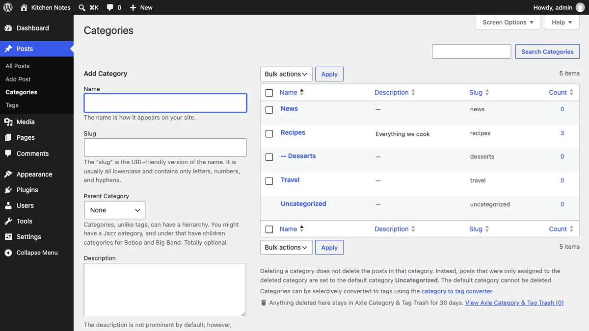
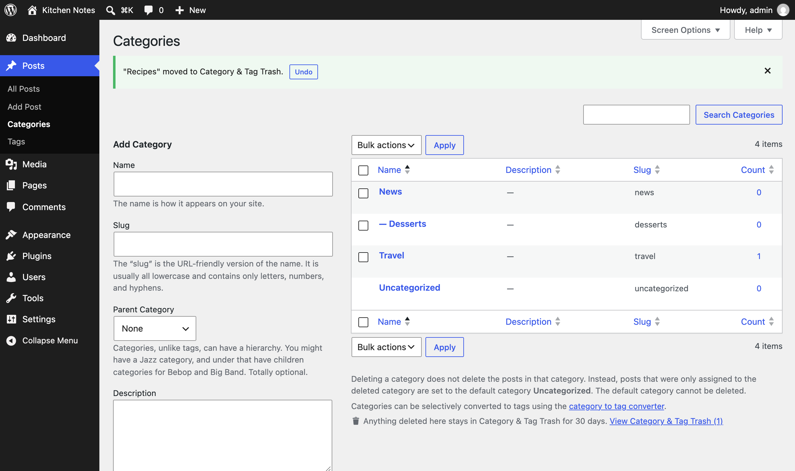
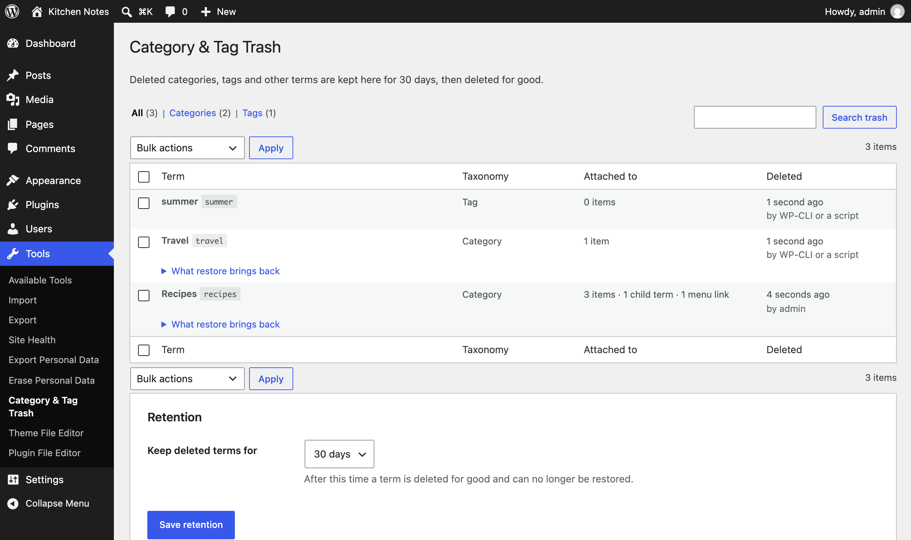
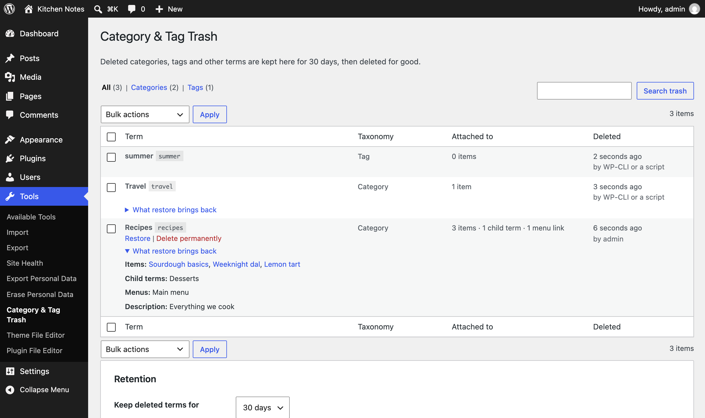

<p align="center"></p>

<h1 align="center">Axle Category & Tag Trash</h1>

<p align="center">
  <a href="https://try.axlewp.com/axle-category-tag-trash"></a>
  <a href="https://github.com/aryanjasala/axle-category-tag-trash/releases/latest"></a>
  
  
  <a href="LICENSE.md"></a>
  <br>
  <a href="https://github.com/aryanjasala/axle-category-tag-trash/actions/workflows/phpcs.yml"></a>
  <a href="https://github.com/aryanjasala/axle-category-tag-trash/actions/workflows/phpstan.yml"></a>
  <a href="https://github.com/aryanjasala/axle-category-tag-trash/actions/workflows/unit-tests.yml"></a>
  <a href="https://github.com/aryanjasala/axle-category-tag-trash/actions/workflows/e2e-tests.yml"></a>
  <a href="https://github.com/aryanjasala/axle-category-tag-trash/actions/workflows/plugin-check.yml"></a>
</p>

<p align="center">A trash for WordPress categories, tags and custom terms. Undo a delete in one click, or restore it later with its posts, child terms and menu links.</p>

<p align="center">
   Axle Category & Tag Trash" width="880">
</p>

---

Posts and pages go to the trash when you delete them. Categories and tags don't: one click and the term is gone, its posts move to Uncategorized, its child categories move up a level and its menu links disappear. Axle Category & Tag Trash keeps every deleted term for 30 days and puts all of that back on restore, under the same ID.

> [!NOTE]
> Free and open source under the GPL. No pro version, no upsells, no ads in wp-admin, no tracking. And it stays that way.
>
> Part of [Axle](https://axlewp.com/) by AryanX, a family of free plugins for running WordPress sites safely.

## Features

- **Undo** right after a delete, on every term screen, for single and bulk deletes
- **Same ID** on restore, so navigation blocks, widgets and shortcodes that store the ID work again
- **Everything comes back**: term meta, posts (in the same order), child terms and menu links in their menu position
- Posts that only got **Uncategorized** because of the delete lose it again
- **Tools > Axle Category & Tag Trash**: taxonomy tabs, search, bulk restore and delete, Empty trash, and what each restore brings back
- Kept for **7, 30, 90 or 365 days**, then a daily task deletes them for good
- Categories, tags, WooCommerce product categories and attributes, and any custom taxonomy with an admin screen

## Install

1. Download `axle-category-tag-trash.zip` from the [latest release](https://github.com/aryanjasala/axle-category-tag-trash/releases/latest).
2. In WordPress, go to **Plugins > Add New Plugin > Upload Plugin**, choose the zip and activate it.

Or with WP-CLI:

```sh
wp plugin install https://github.com/aryanjasala/axle-category-tag-trash/releases/latest/download/axle-category-tag-trash.zip --activate
```

Needs WordPress 6.6+ and PHP 7.4+. To try it first, [try.axlewp.com/axle-category-tag-trash](https://try.axlewp.com/axle-category-tag-trash) opens a private WordPress in your browser with the latest release and some demo content. Nothing to install.

## Quick look

Everything on the screen is also on WP-CLI:

```sh
wp axle-category-tag-trash list --taxonomy=category
wp axle-category-tag-trash restore 42
wp axle-category-tag-trash delete --all
```

## Screenshots

<table>
  <tr>
    <td width="50%" valign="top"><br><sub>Undo right after deleting a category</sub></td>
    <td width="50%" valign="top"> Axle Category & Tag Trash"><br><sub>Tools > Axle Category & Tag Trash</sub></td>
  </tr>
  <tr>
    <td width="50%" valign="top"><br><sub>What a restore brings back</sub></td>
  </tr>
</table>

## Documentation

| Doc | What it covers |
| --- | --- |
| [Reference](docs/REFERENCE.md) | Hooks, WP-CLI, the PHP API and what is stored |
| [Development](docs/DEVELOPMENT.md) | Local setup, commands and tests |
| [Contributing](docs/CONTRIBUTING.md) | Pull requests, required checks and PR titles |
| [Releasing](docs/RELEASING.md) | How merged pull requests become releases |
| [Security](docs/SECURITY.md) | Reporting a vulnerability |
| [readme.txt](readme.txt) | What WordPress.org shows, with the FAQ and changelog |

## Project structure

```
axle-category-tag-trash.php           plugin header and PSR-4 autoloader
src/
├── Plugin.php           creates the services
├── Snapshot.php         everything about a term at the moment it was deleted
├── Snapshotter.php      captures terms on pre_delete_term, saves on delete_term
├── Restorer.php         puts a term, its posts, children and menu links back
├── Trash.php            storage (a hidden post type) and queries
├── Purger.php           daily cleanup after the retention period
├── Admin/               trash screen, list table, Undo notices
└── Cli/Command.php      wp axle-category-tag-trash
assets/                  term screen script and styles
tests/
├── Unit/                PHPUnit
└── e2e/                 Playwright specs and the Docker site
.wordpress-org/          screenshots
docs/                    reference, development, contributing, releasing
```

## More free plugins

Small plugins that each fill one gap in WordPress, all free with no pro version. Try them all together at [demo.axlewp.com](https://demo.axlewp.com/).

| | Plugin | What it does |
| --- | --- | --- |
|  | [Page Template Usage](https://github.com/aryanjasala/page-template-usage) | See which template every page uses, and fix the pages on a missing template |
|  | [Axle Staging Guard](https://github.com/aryanjasala/axle-staging-guard) | Stops staging copies from emailing real people or getting indexed |
|  | [Axle Read-Only Mode](https://github.com/aryanjasala/axle-read-only-mode) | Read-only mode for WordPress during migrations and deploys |
|  | [Axle Block Restore](https://github.com/aryanjasala/axle-block-restore) | Restore a single block from an old revision, not the whole post |
|  | [Activity Log with Undo](https://github.com/aryanjasala/activity-log-with-undo) | An activity log where every change you can reverse has an Undo button |
|  | [Agent Governance](https://github.com/aryanjasala/agent-governance) | Hold risky AI agent calls for approval, preview what they change, and roll back a session |
|  | [Axle AI Guard](https://github.com/aryanjasala/axle-ai-guard) | See and control every AI call your plugins make: cost, data sent, budgets and a kill switch |
|  | [Axle Config Sync](https://github.com/aryanjasala/axle-config-sync) | Keep settings in git, diff them against the live site, apply with a preview and undo |
|  | [Axle Leftovers](https://github.com/aryanjasala/axle-leftovers) | Find what deleted plugins left behind, see who owns it and why, and clean it up with undo |
|  | [Axle License Tracker](https://github.com/aryanjasala/axle-license-tracker) | See which premium plugins are licensed, which lapsed and stopped getting updates, and what renews when |
|  | [Axle Review](https://github.com/aryanjasala/axle-review) | Share drafts through private links and collect outside feedback as block Notes |
|  | [Axle Runtime Doctor](https://github.com/aryanjasala/axle-runtime-doctor) | Check OPcache coverage, the object cache, PHP support and limits, cron and more, with the fix for your host |
|  | [Axle Smoke Test](https://github.com/aryanjasala/axle-smoke-test) | Check key pages after every update or deploy, see what broke and roll it back |
|  | [Block Doctor](https://github.com/aryanjasala/block-doctor) | Scan the whole site for invalid and broken blocks and fix them in bulk, with undo |
|  | [Block Theme Ops](https://github.com/aryanjasala/block-theme-ops) | Find Site Editor changes that override your theme files, see the diff, reset them or send them to Git |
|  | [Role Right-Sizer](https://github.com/aryanjasala/role-right-sizer) | Recommends the smallest role each user needs, from what they actually do |
|  | [Update Rehearsal](https://github.com/aryanjasala/update-rehearsal) | Try plugin, theme, core and PHP updates on a disposable copy of your site in WordPress Playground first |
|  | [User Session Manager](https://github.com/aryanjasala/user-session-manager) | See every device signed in, sign out one, and limit sessions per role |

## License

Copyright Aryan Jasala. Licensed under [GPL-2.0-or-later](LICENSE.md).
